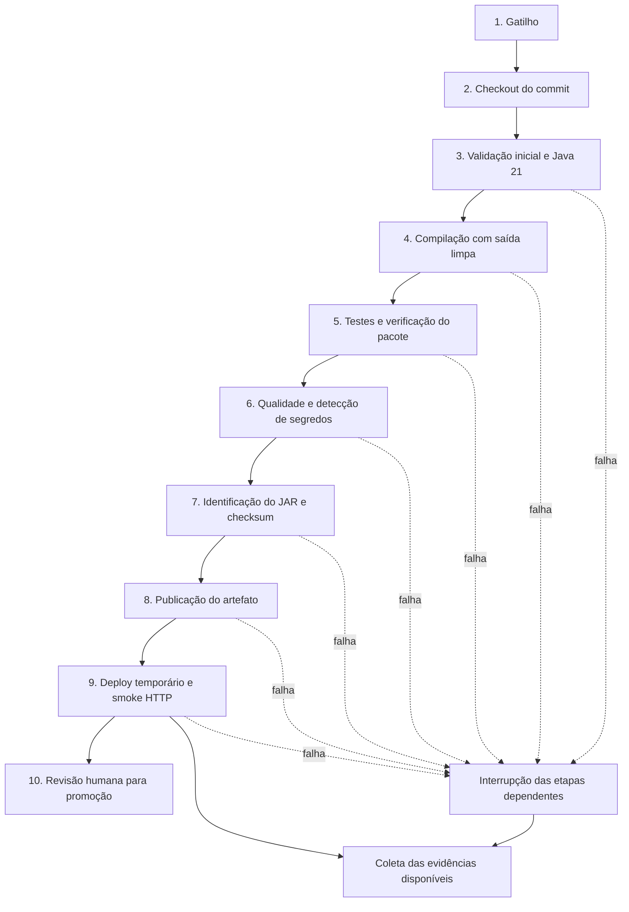

# Trabalho 5 — Integração contínua da Biblioteca

| Integrantes | RA |
| --- | --- |
| Rafael Colombo da Silva | 14551 |
| Ryan Alexandre da Costa | 14647 |

**Repositório:** [Rafaelcolombo23/biblioteca-ci-t5](https://github.com/Rafaelcolombo23/biblioteca-ci-t5).

## Contexto e objetivo

Neste trabalho, estruturamos um fluxo de integração contínua para a aplicação Biblioteca, que permite cadastrar, consultar, atualizar e excluir autores e livros. Nosso objetivo foi tornar a construção da aplicação repetível a partir do repositório, detectar falhas antes da seleção de uma versão e manter a relação entre código, testes, pacote gerado e resultado da execução.

A solução trata três problemas associados a processos manuais: diferenças entre ambientes de desenvolvimento, descoberta tardia de defeitos e dificuldade para identificar qual versão foi testada. Adotamos o GitHub Actions para automatizar a validação, a compilação, os testes, a detecção de segredos, a publicação do pacote e sua inicialização em um ambiente temporário.

A Biblioteca utiliza Java 21, Spring Boot 4.0.6, Spring Data JPA, Thymeleaf e H2 em memória. Fixamos o Maven 3.9.15 pelo Maven Wrapper. No CI, o job executa em Ubuntu 24.04 com Java Temurin 21.0.10. O produto gerado é um JAR executável identificado pelo SHA completo do commit, acompanhado de manifesto e checksum SHA-256.

## Organização do pipeline

Definimos três formas de início: `push` na branch `main`, `pull_request` com destino à `main` e acionamento manual por `workflow_dispatch`. A configuração está versionada em [`.github/workflows/ci.yml`](../.github/workflows/ci.yml), junto ao código que ela verifica.

O checkout usa a revisão associada ao evento e confirma que o `HEAD` corresponde ao SHA esperado. Nos pull requests, essa revisão é o commit de integração gerado pelo GitHub. O manifesto registra também o SHA da branch de origem, permitindo distinguir o código proposto da revisão efetivamente testada.

Organizamos o fluxo em dez etapas. As operações automatizadas são sequenciais dentro do job `ci`; a decisão de promoção permanece humana. Cada etapa depende do sucesso da anterior. A coleta de evidências usa `if: always()` para preservar os resultados disponíveis mesmo quando uma etapa falha.

A compilação começa com `clean compile`, removendo as saídas anteriores. O cache armazena dependências Maven e reduz downloads, enquanto as classes da aplicação são reconstruídas. Em seguida, o ciclo `verify` executa os testes e produz o JAR base somente após sua aprovação. A opção `-DfailIfNoTests=true` impede que uma execução sem testes encontrados seja considerada bem-sucedida.

A publicação do pacote ocorre antes do smoke HTTP. Por isso, definimos que a existência de um artefato publicado não autoriza sua promoção: a aprovação depende do resultado completo do job, incluindo o smoke, e da revisão das evidências.

### Entradas, processamento e saídas

| Etapa | Entrada | Ação executada | Saída |
| --- | --- | --- | --- |
| 1. Gatilho | Evento de push, pull request ou acionamento manual. | GitHub Actions avalia o evento e agenda o job para a referência correspondente. | Execução identificada por evento, referência, commit, número e tentativa. |
| 2. Checkout | Repositório e revisão definidos pelo evento. | O código e o histórico são obtidos; o SHA do checkout é conferido. | Workspace com a revisão efetivamente testada. |
| 3. Validação inicial | Código obtido, `pom.xml`, Wrapper e executor Ubuntu. | Java é configurado; arquivos necessários, versões e configuração Maven são validados. | Ambiente preparado com Java 21 e Maven 3.9.15. |
| 4. Build | Código validado, JDK e dependências. | `./mvnw --batch-mode --no-transfer-progress clean compile`. | Classes e recursos compilados em `target/`. |
| 5. Testes | Aplicação compilada, testes e H2 em memória. | `./mvnw --batch-mode --no-transfer-progress -DfailIfNoTests=true verify`. | Relatórios Surefire dos oito testes e JAR base após aprovação. |
| 6. Qualidade e segurança | Resultados de compilação/testes e histórico obtido. | Gitleaks 8.24.3 verifica possíveis segredos, com valores sensíveis ocultados: intervalo do push/PR ou histórico completo no disparo manual. | Resultado do scanner e relatório SARIF. |
| 7. Artefato | JAR verificado e metadados do commit/execução. | `scripts/prepare-artifact.py` identifica o JAR e gera manifesto e checksum. | `dist/biblioteca-<SHA>.jar`, `MANIFEST.txt` e `SHA256SUMS`. |
| 8. Publicação | Pacote identificado. | Upload do artefato `biblioteca-<SHA completo>` no GitHub Actions, com retenção de 30 dias. | Pacote associado à execução e disponível para download. |
| 9. Deploy de teste | O mesmo JAR produzido pelo pipeline. | `scripts/smoke-test.sh` inicia a aplicação temporariamente, verifica HTTP e conteúdo em `/livros` e encerra o processo. | Confirmação de inicialização e atendimento da verificação HTTP básica. |
| 10. Promoção | Job concluído, pacote identificado e evidências acessíveis. | Revisão humana do resultado completo e da rastreabilidade antes da seleção de uma versão. | Aprovação ou solicitação de correção; não há execução automática de produção. |

### Falhas, evidências e responsabilidades

Organizamos as responsabilidades por função no processo: manutenção do CI, autoria da alteração, testes e revisão. Falhas de infraestrutura ficam sob responsabilidade da manutenção do pipeline; defeitos de comportamento são tratados pela autoria da alteração em conjunto com a revisão da equipe.

| Etapa | Condição de falha | Evidência disponível | Responsabilidade |
| --- | --- | --- | --- |
| 1. Gatilho | Workflow inválido, Actions desabilitado ou indisponibilidade do serviço. | Página da execução ou diagnóstico de configuração; eventos que não iniciam podem não gerar artefatos. | Manutenção do CI e administração do repositório. |
| 2. Checkout | Falha de acesso, referência inexistente ou erro de rede. | Log do checkout e metadados da execução. | Manutenção do CI e administração do repositório. |
| 3. Validação inicial | Arquivo necessário ausente, configuração inválida ou ferramenta indisponível. | `versions.log` e `validate.log`. | Manutenção do CI e do build. |
| 4. Build | Erro de compilação ou de resolução de dependências. | `build.log` e código de saída do Maven. | Autoria da alteração; manutenção do CI para falhas de infraestrutura. |
| 5. Testes | Asserção incorreta, exceção, ausência de testes ou erro de empacotamento. | `tests.log` e relatórios de `target/surefire-reports/`. | Autoria da alteração e manutenção dos testes. |
| 6. Qualidade e segurança | Possível segredo detectado ou erro no scanner. | Log do Gitleaks e `gitleaks.sarif`, com valores sensíveis ocultados. | Autoria da alteração e revisão de segurança; manutenção do CI para erro da ferramenta. |
| 7. Artefato | JAR ausente ou ambíguo, divergência do checkout ou erro de identificação. | Log do script, manifesto e checksum gerados. | Manutenção do build e autoria da alteração. |
| 8. Publicação | Arquivo ausente, erro de upload ou limite do serviço. | Log de upload e registro do artefato. | Manutenção do CI e administração do repositório. |
| 9. Deploy de teste | Aplicação não inicia no prazo, retorna erro HTTP ou conteúdo inesperado. | `application.log`, `smoke.log`, cabeçalhos HTTP e página obtida. | Autoria da alteração; manutenção do CI para falhas do executor. |
| 10. Promoção | Etapa obrigatória reprovada, evidência insuficiente, divergência de identificação ou revisão não aprovada. | Resultado do job, metadados do pacote e registro da revisão quando realizado. | Revisão da equipe. |

O smoke aguarda até 90 segundos pela inicialização do processo e consulta `http://127.0.0.1:8080/livros`. A aprovação exige HTTP 200 e os textos `Livros` e `Novo livro`. Nesse ambiente, utilizamos H2 em memória com o console desabilitado. O processo é encerrado pelo próprio script ao finalizar a verificação.

## Rastreabilidade e segurança

Associamos cada pacote ao SHA completo do commit testado. O manifesto reúne nome do JAR, checksum, commit, evento, URL da execução, tentativa e versões de Java e Maven. Essa identificação permite relacionar o arquivo distribuído à revisão que passou pelas verificações, inclusive quando um pull request utiliza um commit de integração diferente do último commit de sua branch.

Os logs e relatórios são reunidos no artefato `evidencias-<SHA>-<run_id>-<run_attempt>`. A coleta registra os resultados individuais das etapas em `execution.txt` e inclui os arquivos produzidos até o ponto em que a execução chegou. Uma falha nos testes, por exemplo, preserva o relatório correspondente, mas não produz um resultado do scanner que ainda não foi executado.

Adotamos retenção de 30 dias para os artefatos do Actions e preservamos cópias dos relatórios selecionados em `docs/evidencias/`. O registro detalhado das execuções está em [EVIDENCIAS.md](EVIDENCIAS.md).

O workflow usa `GITHUB_TOKEN` com `contents: read`, ações referenciadas por commit e checkout sem persistência de credenciais. O build e os testes não dependem de segredos externos. A verificação do Gitleaks oculta valores sensíveis para reduzir sua exposição em relatórios. A configuração atual oferece detecção básica de segredos; o resultado do scanner se refere ao conteúdo efetivamente analisado.

## Riscos e medidas adotadas

| Risco | Consequência | Tratamento na solução |
| --- | --- | --- |
| Testes insuficientes | Um comportamento incorreto pode passar pelo CI. | Oito testes de integração e smoke do JAR exercitam comportamentos definidos; a cobertura funcional permanece limitada aos cenários implementados. |
| Dependência indisponível | A construção não consegue obter uma ferramenta ou biblioteca. | Versões definidas no projeto/Wrapper, cache Maven e logs de resolução reduzem variação e ajudam no diagnóstico. O cache não elimina a dependência de serviços externos. |
| Segredo exposto | Credenciais publicadas podem ser utilizadas indevidamente. | O fluxo não requer segredos externos, usa token de leitura e executa Gitleaks com valores sensíveis ocultados. |
| Artefato com identificação ambígua | Uma versão diferente da testada pode ser selecionada. | SHA completo no nome do JAR e do pacote, manifesto da execução e checksum SHA-256. |
| Executor com permissões excessivas | Código executado no CI pode alcançar recursos além do necessário. | Runner hospedado, permissão `contents: read`, ausência de credenciais de produção e ações fixadas por commit. |
| Falha de publicação | O build termina, mas os arquivos não ficam disponíveis. | Upload do pacote integra o resultado obrigatório do job; a coleta de evidências ocorre mesmo após falhas anteriores. |
| Diferenças entre ambientes | Um comportamento validado com H2 pode divergir em outra configuração. | O smoke usa o próprio JAR produzido e registra o ambiente utilizado; a validação se limita ao H2 em memória e ao executor configurado. |
| Expiração de evidências | Os arquivos deixam de estar disponíveis no Actions. | Retenção de 30 dias, download dos artefatos e preservação de relatórios selecionados no repositório. |
| Publicação anterior ao smoke | Um pacote disponível pode ser confundido com uma versão aprovada. | A condição de promoção depende do job inteiro aprovado, incluindo smoke e revisão humana. |

Consideramos a insuficiência de testes o principal risco residual. Os cenários existentes verificam carga inicial, relacionamentos, busca por título, paginação, cadastro após a carga inicial, ISBN único, exclusão de autores com livros e entidades inexistentes. O smoke acrescenta a inicialização do pacote e uma resposta HTTP. Esses resultados não representam cobertura integral de todos os fluxos da interface ou de todas as condições de uso.

## Resultados observados

A execução do pipeline detectou um defeito real no cadastro de autores. A carga inicial em `data.sql` inseria IDs explícitos, enquanto os novos cadastros dependiam de IDs gerados pelo H2. O teste `cadastraAutorELivroAposCargaInicialEPersisteRelacionamento` tentou inserir um autor e encontrou colisão com a chave primária de valor `1`.

Na [execução 38650134855](https://github.com/Rafaelcolombo23/biblioteca-ci-t5/actions/runs/38650134855), associada ao commit [`595a9e4c288ee9d9054b2f270ef1d7a75ebe6399`](https://github.com/Rafaelcolombo23/biblioteca-ci-t5/commit/595a9e4c288ee9d9054b2f270ef1d7a75ebe6399), a compilação passou e os testes registraram sete aprovações e um erro. O pipeline interrompeu as etapas de segurança, identificação do pacote, publicação e smoke. A coleta e o upload das evidências foram concluídos, preservando o erro `DataIntegrityViolationException` e os estados das etapas.

Corrigimos a carga inicial para que o H2 gerasse os IDs dos autores e livros. Os vínculos dos livros passaram a obter `autor_id` por subconsulta ao nome do autor. Mantivemos o teste que revelou o problema como teste de regressão.

O commit [`7294b5e109278c74c9b65a91a63d54b5c29102a4`](https://github.com/Rafaelcolombo23/biblioteca-ci-t5/commit/7294b5e109278c74c9b65a91a63d54b5c29102a4) produziu a [execução 38650549205](https://github.com/Rafaelcolombo23/biblioteca-ci-t5/actions/runs/38650549205), na qual todas as etapas foram aprovadas. Os oito testes passaram, o Gitleaks apresentou zero achados no intervalo analisado e o smoke retornou HTTP 200 com o conteúdo esperado.

| Resultado | Execução com defeito | Execução após correção |
| --- | --- | --- |
| Evento | Push em `main`, tentativa 1. | Push em `main`, tentativa 1. |
| Testes | 8 executados; 0 falhas de asserção; 1 erro; 0 ignorados. | 8 executados; 0 falhas; 0 erros; 0 ignorados. |
| Etapas seguintes aos testes | Ignoradas após o erro. | Segurança, artefato, publicação e smoke aprovados. |
| Evidências | Coletadas e publicadas. | Coletadas e publicadas. |
| Intervalo em 14/10/2026, UTC | 22:48:38–22:49:18. | 22:52:29–22:53:47. |
| Tempo entre criação e conclusão | 40 segundos. | 78 segundos. |

O pacote aprovado foi identificado como `biblioteca-7294b5e109278c74c9b65a91a63d54b5c29102a4`. Seu manifesto registra o checksum SHA-256 `aa5ee28295c733bb03fa601a72f63b1ab899041e6b7dc554082d1c80939ae89b` para o JAR. Também validamos a correção localmente em macOS arm64 com Microsoft OpenJDK 21.0.10: o build passou com oito testes aprovados e o JAR respondeu HTTP 200 no smoke.

A falha observada demonstrou que o fluxo detectou o defeito durante os testes, antes da publicação do pacote, e preservou informações suficientes para identificar sua causa. A execução posterior relacionou a correção ao mesmo teste de regressão e ao artefato aprovado.

## Alcance da implementação

A solução automatiza a construção e a verificação da Biblioteca a partir do repositório, com interrupção em caso de erro, artefato rastreável e evidências de sucesso e de falha. O ambiente temporário confirma que o JAR inicia e atende à verificação HTTP definida.

O H2 utiliza armazenamento em memória, e os dados não persistem entre execuções da aplicação. O pipeline não realiza implantação em produção, não produz imagem de contêiner e não inclui análise estática dedicada, análise de vulnerabilidades das dependências ou medição de cobertura. A promoção foi definida como uma decisão humana baseada no resultado completo do CI e nas evidências; sua aplicação a um ambiente de produção está fora do fluxo implementado.
