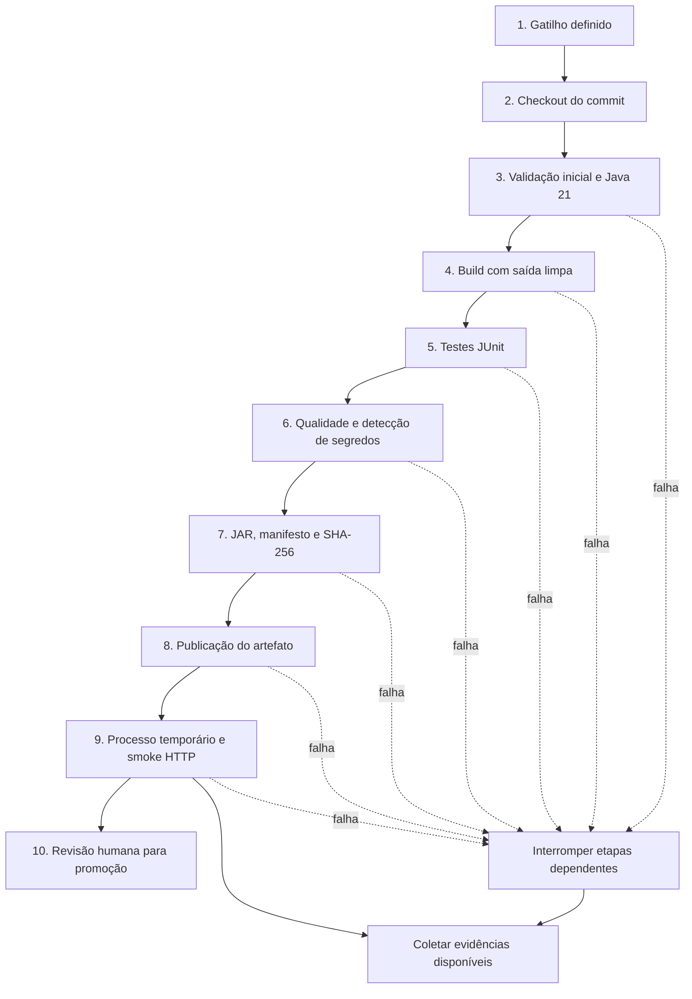

# Trabalho 5 — Biblioteca

**Tema:** Pipeline CI mínimo e reprodutível.

**Repositório:** [Rafaelcolombo23/biblioteca-ci-t5](https://github.com/Rafaelcolombo23/biblioteca-ci-t5).

**Ferramenta:** GitHub Actions.

**Integrantes informados:** Rafael Colombo da Silva — RA 14551; Ryan Alexandre da Costa — RA 14647.

**Turma e professor:** a preencher pela equipe.

**Entrega:** Aula 10, após a semana da Jornada Acadêmica; data a confirmar com o professor.

Este documento segue a ordem e os títulos dos slides 57–67. As decisões técnicas descrevem o fluxo definido para a Biblioteca. A comprovação de execução, incluindo links, resultados e commits, deve ser consultada em [EVIDENCIAS.md](EVIDENCIAS.md). Campos ainda pendentes não representam uma execução realizada.

---

## Slide 57: Atividade Prática — Contexto

- **Equipes:** o enunciado propõe 3–5 alunos. Os integrantes informados são Rafael Colombo da Silva (RA 14551) e Ryan Alexandre da Costa (RA 14647); organização final conforme orientação do professor.
- **Tempo sugerido:** 35–45 minutos.
- **Produto:** Aplicação Biblioteca, com cadastro, consulta, atualização e exclusão de autores e livros.
- **Tecnologias:** Java 21, Spring Boot 4.0.6, Maven Wrapper com Maven 3.9.15, Thymeleaf, Spring Data JPA e banco H2 em memória.
- **Situação apresentada na atividade:** builds manuais; erros descobertos durante o deploy; ausência de evidência única de testes; nomes inconsistentes para imagens.
- **Objetivo:** modelar e implementar um fluxo automatizado e verificável, capaz de reconstruir a aplicação a partir do repositório e interromper a execução quando uma validação falhar.
- **Aplicação ao projeto:** o produto desta entrega é um JAR executável. Sua identificação usa o SHA completo do commit testado, acompanhado de manifesto e checksum. A construção de imagem de contêiner não faz parte desta implementação.

## Slide 58: Atividade Prática — Desenhar o Pipeline

| Nº | Etapa definida | Dependência e decisão para a Biblioteca |
| --- | --- | --- |
| 1 | Gatilho | `push` na `main`, `pull_request` com destino à `main` ou `workflow_dispatch`. |
| 2 | Checkout | Obter a revisão associada ao evento e registrar sua identidade. Em PR, testar o commit de integração gerado pelo GitHub. |
| 3 | Validação inicial | Preparar Java 21 e conferir Wrapper, estrutura e versões necessárias. |
| 4 | Build | Executar compilação a partir da saída limpa com Maven. |
| 5 | Testes | Executar `verify`, que roda os testes JUnit e só gera o JAR base após aprovação; produzir relatórios Surefire. |
| 6 | Verificação de qualidade e segurança | Exigir compilação/testes válidos e executar Gitleaks para detectar possíveis segredos. Não há gate de cobertura nem scanner de vulnerabilidades das dependências. |
| 7 | Artefato produzido | Identificar o JAR já verificado com SHA completo e gerar manifesto de origem e checksum SHA-256. |
| 8 | Publicação | Publicar o pacote identificado por SHA como artefato do GitHub Actions. |
| 9 | Deploy de teste | Iniciar o JAR temporariamente no executor, testar HTTP em `/livros` e encerrar o processo. |
| 10 | Critério para promoção | Exigir o job completo verde, evidências disponíveis e revisão humana. Não há promoção automática nem produção nesta entrega. |

As etapas operacionais são sequenciais dentro do job `ci`. O upload final de evidências usa uma condição de execução mesmo após falhas anteriores. A etapa 10 é uma decisão humana externa ao job. O cache contém dependências; a aplicação é reconstruída com `clean`. A publicação antecede o smoke: **artefato disponível não equivale a aprovação para promoção**.

## Slide 59: Atividade Prática — Detalhar Cada Etapa

### 1. Gatilho

| Campo | Resposta |
| --- | --- |
| Entrada | Evento `push`, `pull_request` ou solicitação manual com uma referência do repositório. |
| Ação | GitHub Actions avalia os eventos declarados em `.github/workflows/ci.yml` e agenda o job. |
| Saída | Execução identificada por evento, referência, commit, número e tentativa. |
| Falha | Workflow inválido, Actions desabilitado ou indisponibilidade/limite do serviço impede iniciar o job. |
| Evidência | Página da execução ou diagnóstico de configuração do GitHub; uma execução que não iniciou pode não gerar artefatos. |
| Responsabilidade | Responsável por CI e administrador do repositório. |

### 2. Checkout

| Campo | Resposta |
| --- | --- |
| Entrada | Repositório e revisão definidos pelo evento. |
| Ação | Baixar o código e o histórico necessários para as verificações; registrar a revisão testada. |
| Saída | Workspace com código correspondente ao SHA efetivamente obtido. |
| Falha | Falta de acesso, referência inexistente, rede indisponível ou erro de checkout. |
| Evidência | Log do checkout e metadados da execução. |
| Responsabilidade | Responsável por CI; administrador do repositório quando houver problema de acesso. |

### 3. Validação inicial

| Campo | Resposta |
| --- | --- |
| Entrada | Código obtido, `pom.xml`, Maven Wrapper e executor Ubuntu 24.04. |
| Ação | Preparar Java Temurin 21.0.10, validar arquivos necessários e registrar versões Java/Maven. |
| Saída | Ambiente pronto para compilar com Maven 3.9.15. |
| Falha | Wrapper/arquivo necessário ausente, configuração inválida ou falha ao obter a ferramenta. |
| Evidência | Logs de validação e versões. |
| Responsabilidade | Responsável por CI e responsável pelo build. |

### 4. Build

| Campo | Resposta |
| --- | --- |
| Entrada | Código-fonte validado, JDK e dependências Maven. |
| Ação | Executar `./mvnw --batch-mode --no-transfer-progress clean compile`. |
| Saída | Classes e recursos compilados em `target/`. |
| Falha | Erro de compilação, dependência indisponível ou falha do Maven. |
| Evidência | Log de compilação com mensagem de erro e código de saída. |
| Responsabilidade | Autor da alteração; responsável por CI se a causa for infraestrutura. |

### 5. Testes

| Campo | Resposta |
| --- | --- |
| Entrada | Aplicação compilada, código de testes e banco H2 efêmero. |
| Ação | Executar `./mvnw --batch-mode --no-transfer-progress -DfailIfNoTests=true verify`. |
| Saída | Resultado dos oito testes de integração, relatórios Surefire em texto/XML e JAR base se os testes passarem. |
| Falha | Asserção incorreta, exceção, falha de inicialização, ausência de testes ou erro de execução/empacotamento. |
| Evidência | Log de testes e arquivos de `target/surefire-reports/`. |
| Responsabilidade | Autor da alteração e responsável pelos testes. |

### 6. Verificação de qualidade e segurança

| Campo | Resposta |
| --- | --- |
| Entrada | Código/histórico obtidos, configuração do detector e resultados de build/testes. |
| Ação | Executar Gitleaks 8.24.3 com redação de valores sensíveis: intervalo do push/PR ou histórico completo no disparo manual. Usar build e testes como verificações básicas de qualidade. |
| Saída | Resultado da detecção de segredos e relatório correspondente. |
| Falha | Possível segredo detectado ou erro no próprio scanner. |
| Evidência | Log e relatório do detector, com saída redigida. |
| Responsabilidade | Autor da alteração e responsável por segurança/revisão; responsável por CI para erro da ferramenta. |

### 7. Artefato produzido

| Campo | Resposta |
| --- | --- |
| Entrada | Código aprovado nas etapas anteriores e metadados do commit/execução. |
| Ação | Executar `python3 scripts/prepare-artifact.py` para identificar o JAR já verificado e reunir manifesto de origem e checksum SHA-256. |
| Saída | `dist/biblioteca-<SHA>.jar`, `dist/MANIFEST.txt` e `dist/SHA256SUMS`, associados ao SHA completo testado. |
| Falha | JAR não encontrado/ambíguo, divergência de checkout ou erro ao gerar a identificação/checksum. |
| Evidência | Log do script e arquivos de identificação produzidos. |
| Responsabilidade | Responsável pelo build e autor da alteração. |

### 8. Publicação

| Campo | Resposta |
| --- | --- |
| Entrada | Pacote identificado e serviço de artefatos do GitHub Actions. |
| Ação | Fazer upload do artefato `biblioteca-<SHA completo>`, com retenção de 30 dias. |
| Saída | Artefato disponível na página da execução. |
| Falha | Arquivo esperado ausente, erro de upload, limite do serviço ou indisponibilidade. |
| Evidência | Log de upload e item de artefato associado à execução. |
| Responsabilidade | Responsável por CI e administrador do repositório. |

### 9. Deploy de teste

| Campo | Resposta |
| --- | --- |
| Entrada | O JAR produzido pelo pipeline e H2 em memória. |
| Ação | Executar `scripts/smoke-test.sh` para iniciar o JAR temporariamente em `127.0.0.1:8080`, com H2 em memória e console desabilitado; aguardar até 90 segundos, conferir HTTP 200 e os textos `Livros`/`Novo livro` em `/livros` e encerrar o processo. |
| Saída | Confirmação de que o pacote inicia e atende à verificação HTTP básica. |
| Falha | Aplicação não inicia no tempo previsto, responde com erro ou não apresenta o conteúdo esperado. |
| Evidência | Log da aplicação e resultado do smoke, coletados nas evidências da execução. |
| Responsabilidade | Autor da alteração; responsável por CI para problemas do executor. |

### 10. Critério para promoção

| Campo | Resposta |
| --- | --- |
| Entrada | Job concluído, artefato identificado, checksum e evidências acessíveis. |
| Ação | Revisor confere sucesso de todas as etapas e rastreabilidade antes de aceitar a alteração ou selecionar uma versão. |
| Saída | Aprovação humana ou solicitação de correção. Não dispara produção. |
| Falha | Qualquer etapa obrigatória vermelha, evidência insuficiente, revisão pendente ou divergência de identificação impede aprovação. |
| Evidência | Resultado da execução e registro da revisão no pull request, quando houver. |
| Responsabilidade | Revisor da equipe/responsável pela entrega. |

## Slide 60: Atividade Prática — Analisar Riscos

| Risco | Consequência | Mitigação nesta entrega / evolução necessária |
| --- | --- | --- |
| Testes insuficientes | Um defeito pode passar mesmo com pipeline verde. | Executar todos os testes existentes e smoke HTTP; expandir cenários de negócio e regressão conforme novos defeitos forem identificados. Não afirmar cobertura total. |
| Dependência indisponível | Build limpo não consegue baixar uma biblioteca/ferramenta. | Fixar versões no projeto/Wrapper, usar cache de dependências e manter log de resolução; verificar o serviço e repetir após normalização. O cache não garante disponibilidade. |
| Segredo exposto | Uso indevido de credencial divulgada em código ou log. | Projeto sem segredos externos, Gitleaks com saída redigida, revisão e uso de Actions Secrets se necessário. Revogar e substituir credenciais eventualmente expostas. |
| Artefato com nome ambíguo | Entrega de versão diferente da testada. | Usar SHA completo no nome do artefato e manifesto com identidade da execução; validar SHA-256. |
| Executor com permissão excessiva | Código de um PR consegue alterar repositório ou alcançar serviços. | `contents: read`, sem credenciais de produção, execução em runner hospedado e ações fixadas por commit. Revisar qualquer aumento futuro de permissão. |
| Falha de publicação | Build passa, mas pacote/evidências não ficam disponíveis. | Upload obrigatório do pacote e coleta final de evidências; conferir resultado e disponibilidade dos downloads antes da entrega. |
| Ambiente de teste diferente da produção | Erros de banco/configuração podem surgir fora do CI. | Usar o próprio JAR no smoke, documentar Java/H2/runner e limites do teste. Antes de uma futura produção, testar também o banco e a configuração reais. |
| Expiração das evidências | Professor perde acesso aos arquivos da execução. | Retenção de 30 dias e download dos pacotes para a entrega antes da expiração; registrar links, SHAs e resultados em `EVIDENCIAS.md`. |
| Falha no smoke após publicação | Pacote publicado é confundido com versão aprovada. | Condicionar a promoção ao job inteiro verde, incluindo smoke, e à revisão humana. |

**Principal risco escolhido para a apresentação:** testes insuficientes. O smoke confirma inicialização e uma resposta HTTP; ele não comprova todos os fluxos de cadastro, atualização, exclusão e validação. A mitigação combina testes disponíveis, cenário HTTP e expansão de testes orientada aos comportamentos relevantes.

## Slide 61: Atividade Prática — Apresentação

Roteiro para apresentação em até 4 minutos:

| Tempo | Conteúdo |
| --- | --- |
| 0:00–0:30 | Apresentar Biblioteca, contexto e gatilhos: push, PR e acionamento manual. |
| 0:30–1:20 | Mostrar diagrama e etapas, destacando checkout, build limpo e testes bloqueantes. |
| 1:20–2:00 | Mostrar JAR identificado pelo commit, manifesto, checksum e smoke do pacote. |
| 2:00–3:00 | Abrir evidência de sucesso e a falha real de cadastro; mostrar passo vermelho, relatório, interrupção das etapas dependentes e correção da carga inicial. |
| 3:00–3:35 | Explicar principal risco: testes insuficientes; apresentar mitigação e limitações. |
| 3:35–4:00 | Responder às perguntas e concluir com o resultado observável no GitHub Actions. |

- **Gatilho:** evento declarado em `.github/workflows/ci.yml`.
- **Etapas:** as dez etapas do Slide 58; revisão de promoção é humana.
- **Artefato:** JAR executável identificado pelo SHA do commit, com manifesto e checksum.
- **Condições de falha:** erro de validação, compilação, teste, scanner, empacotamento, upload ou smoke.
- **Evidências geradas:** logs, relatórios Surefire, relatório do scanner, execução HTTP e metadados do artefato.
- **Principal risco e mitigação:** testes insuficientes; executar testes existentes e smoke, ampliando cenários de negócio.

**Pergunta para a turma: em qual ponto um defeito seria descoberto?** Erro de sintaxe no build; regressão coberta por teste na etapa de testes; possível segredo no scanner; falha de inicialização/HTTP no smoke. Um comportamento sem teste pode não ser descoberto.

**O feedback chegaria cedo o suficiente?** Para esses casos cobertos, o feedback ocorre no CI antes de uma eventual promoção. O tempo real deve ser obtido nas execuções registradas, sem estimativa apresentada como medição.

## Slide 62: Trabalho 5 — Lançamento

- **Tema:** Pipeline CI mínimo e reprodutível.
- **Valor:** até 1,0 ponto.
- **Equipes:** conforme organização definida pelo professor; integrantes informados na abertura deste documento.
- **Entrega:** Aula 10, após a semana da Jornada Acadêmica; data a confirmar.
- **Ferramenta escolhida:** GitHub Actions.
- **Projeto:** Biblioteca em Java/Spring Boot.

## Slide 63: T5 — Objetivo

Implementar um pipeline que possa ser repetido a partir do repositório.

| Requisito | Implementação definida |
| --- | --- |
| Ser iniciado por evento definido | Eventos `push`, `pull_request` e `workflow_dispatch`. |
| Obter o código correto | Checkout da referência do evento; SHA registrado para rastreabilidade. |
| Executar build | Maven Wrapper e compilação a partir de `clean`. |
| Executar testes disponíveis | Maven/JUnit e relatórios Surefire, além de smoke HTTP do JAR. |
| Interromper em caso de falha | Erro em etapa obrigatória impede as seguintes; coleta de evidências permanece habilitada. |
| Produzir ou identificar um artefato | JAR, manifesto e checksum em pacote identificado pelo SHA. |
| Manter evidências de execução | Logs do Actions e pacote de evidências com retenção de 30 dias. |

A Aula 10 aprofundará configuração e ferramentas de CI, conforme o enunciado. A configuração presente deve ser validada pelas execuções registradas, independentemente dessa aula.

## Slide 64: T5 — Entregáveis

| Entregável | Local e comprovação |
| --- | --- |
| Repositório da equipe | [Rafaelcolombo23/biblioteca-ci-t5](https://github.com/Rafaelcolombo23/biblioteca-ci-t5), criado com visibilidade pública. |
| Arquivo de definição do pipeline | [`.github/workflows/ci.yml`](../.github/workflows/ci.yml). |
| Instruções para execução | [`README.md`](../README.md), com comandos para Linux/macOS/Windows. |
| Gatilho, etapas e dependências | Slides 58 e 59 deste documento e workflow executável. |
| Identificação do artefato | Nome com SHA completo, manifesto e checksum do pacote. |
| Evidência de execução bem-sucedida | Registro de sucesso em [`EVIDENCIAS.md`](EVIDENCIAS.md), associado a URL e commit. |
| Evidência de falha detectada | Registro do erro real de colisão de IDs após carga inicial em [`EVIDENCIAS.md`](EVIDENCIAS.md). |
| Como reproduzir | Clonar a revisão desejada, usar JDK 21 e executar Maven Wrapper; workflow manual para reproduzir CI completo. |
| Como investigar falhas | Abrir primeiro passo com erro, conferir SHA e ler logs/relatórios; instruções no README. |
| Como os segredos são protegidos | Nenhuma credencial externa necessária, token mínimo, scanner redigido, revisão e uso de Actions Secrets em integrações futuras. |

**Falha escolhida para evidência:** o teste `cadastraAutorELivroAposCargaInicialEPersisteRelacionamento` revelou que os IDs explícitos de `data.sql` podiam colidir com IDs gerados pelo H2 ao cadastrar um novo autor. O teste permanece como regressão. Registrar a execução anterior à correção, com o erro de chave duplicada e as etapas dependentes ignoradas, e uma execução posterior com a carga inicial corrigida. Não é necessário introduzir um defeito artificial. Os links e resultados comprovados estão em `EVIDENCIAS.md`.

## Slide 65: T5 — Escopo Mínimo

| Obrigatório | Atendimento previsto na configuração |
| --- | --- |
| Checkout | Código da revisão associada ao evento. |
| Build | Compilação limpa e empacotamento Maven. |
| Testes existentes | Execução de todos os testes configurados no projeto. |
| Resultado visível | Status do job, log e resumo no GitHub Actions. |
| Artefato identificado | JAR e pacote identificados pelo SHA do commit. |

| Recomendado, quando aplicável | Decisão |
| --- | --- |
| Cache de dependências | Configurado para dependências Maven; não substitui build limpo. |
| Análise estática | Não há analisador estático dedicado nesta entrega; compilação e testes são as verificações básicas de qualidade. |
| Construção de imagem | Fora do escopo implementado; o artefato é um JAR executável. |
| Detecção de segredos | Gitleaks, com saída redigida. |

**Não é obrigatório nesta entrega:** deploy automático em produção e estratégias blue/green ou canary. O processo temporário no executor serve apenas como deploy de teste.

## Slide 66: T5 — Critérios de Avaliação

| Critério | Valor | Onde verificar |
| --- | --- | --- |
| Pipeline executável e reprodutível | Não informado no enunciado | Workflow, Wrapper, versões e instruções do README. |
| Build, testes e tratamento de falhas | Não informado no enunciado | Execução verde, execução anterior com falha real e relatórios de testes. |
| Artefato e rastreabilidade | Não informado no enunciado | Pacote com SHA, manifesto, checksum e associação à execução. |
| Evidências e instruções | Não informado no enunciado | README, este documento e `EVIDENCIAS.md`. |
| Segurança básica e organização | Não informado no enunciado | Permissões do workflow, scanner, ausência de credenciais externas e estrutura do repositório. |
| **Total** | **1,00** | Avaliação do professor. |

Os pesos individuais e a nota efetivamente recebida não foram informados; não são presumidos neste documento.

## Slide 67: Checklist do Trabalho 5

Revisão baseada na [execução com falha 38650134855](https://github.com/Rafaelcolombo23/biblioteca-ci-t5/actions/runs/38650134855), na [execução completa com sucesso 38650549205](https://github.com/Rafaelcolombo23/biblioteca-ci-t5/actions/runs/38650549205) e na validação local da correção. Os resultados e os arquivos preservados estão em [EVIDENCIAS.md](EVIDENCIAS.md).

| Pergunta | Estado | Como comprovar |
| --- | --- | --- |
| O repositório pode ser acessado pelo professor? | Sim, repositório público | Link do repositório, documentação e relatórios preservados em `docs/evidencias/`; download de artefatos do Actions pode exigir conta autenticada. |
| O pipeline possui um gatilho compreensível? | Verificado na definição e em execução | `on:` declara push, PR e disparo manual; execução 38650134855 iniciada por push na main. |
| O build parte de ambiente limpo? | Verificado na execução | Runner hospedado; etapa `clean compile` concluída com sucesso. |
| Testes são executados? | Verificado no CI e localmente | Oito testes no CI: a primeira execução detectou um erro; após a correção, oito passaram sem falhas, erros ou testes ignorados. |
| Uma falha interrompe corretamente o fluxo? | Verificado no CI | Testes falharam; segurança, identificação do pacote, publicação e smoke ficaram ignorados. Coleta de evidências continuou. |
| O artefato possui identificação? | Verificado | Pacote e JAR com SHA completo `7294b5e109278c74c9b65a91a63d54b5c29102a4`, manifesto e SHA-256 registrados em `EVIDENCIAS.md`. |
| A execução pode ser associada ao commit? | Verificado para falha e sucesso | SHAs diferentes identificam o defeito e a correção; `execution.txt` e `MANIFEST.txt` vinculam execução e artefato ao commit testado. |
| Logs e evidências estão disponíveis? | Verificado | Duas execuções com links; artefatos baixados e relatórios selecionados preservados em `docs/evidencias/`. |
| Não existem segredos no repositório ou nos logs? | Scanner aprovado sem achados no intervalo analisado | SARIF contém zero resultados; o fluxo não precisa de credenciais externas, usa token de leitura e saída redigida. A verificação automatizada não equivale a garantia absoluta. |
| Outra equipe conseguiria reproduzir o processo? | Instruções e execuções comprovadas | README fornece comandos com Wrapper/JDK 21; build, oito testes e smoke passaram localmente e no CI. `EVIDENCIAS.md` ensina a repetir a falha e retornar à `main`. |
